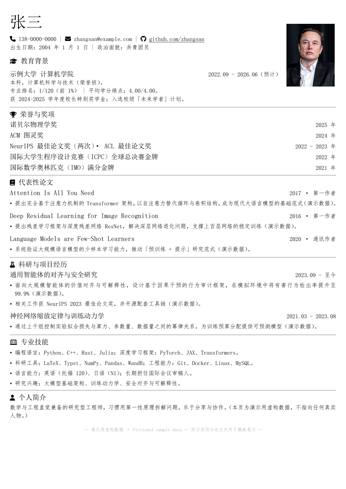
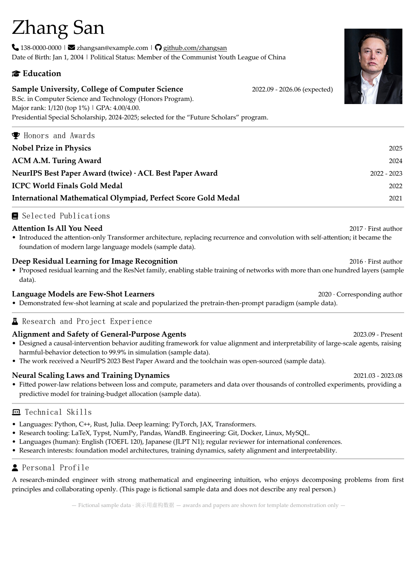

# resume-demo — Bilingual Resume Template for Typst

English | [中文](README.zh-CN.md)

> **Sample data notice** — Every piece of resume content in this repository is fictional.
> The "Zhang San" persona, the Nobel Prize and Turing Award mentions, the publication list
> (including *Attention Is All You Need*) and the portrait are placeholders used to preview
> the template. They describe no real person and make no real claims.

A compact, one-page, bilingual resume template written in [Typst](https://typst.app/).
Two sources (`resume-cn.typ`, `resume-en.typ`) share one style module and compile to A4 PDFs
in Chinese and English. Private fields (name, phone) are injected from a separate JSON file,
so the public sources stay clean.

## Screenshots

| Chinese (中文) | English |
| --- | --- |
|  |  |

## Project Overview

This repository is a ready-to-fork starting point for a one-page resume in two languages.
The layout is built for dense, high-signal resumes: a two-column header with a 2.9 × 3.8 cm
ID-photo slot, section headings with Font Awesome icons, compact two-column entries, and a
redaction mechanism that can hide selected fields when a resume is posted publicly.

The repository ships with a fictional sample persona so that every build and every screenshot
can be reproduced end to end without exposing anyone's personal data.

## Features

- One-page A4 resumes in Chinese and English, kept in sync from two `.typ` sources.
- Shared style module (`chicv.typ`) with Font Awesome icons and a header grid.
- ID-photo slot (`photo.jpg`) sized for standard 2.9 × 3.8 cm portraits.
- Private fields live in `resume-private/private_info.json` and are injected at build time.
- Redaction support: `--input level=submit` renders everything, `--input level=post` can
  cover or replace selected fields for public posting.
- Build with `make`, or with the equivalent `make.ps1` on Windows.
- `scripts/render_preview.py` renders README-quality PNG previews from the compiled PDFs.

## Installation

Requirements:

- [Typst](https://github.com/typst/typst#installation) 0.13+ (developed and tested with 0.15.1)
- GNU Make, or PowerShell on Windows
- Python 3.10+ *(optional, only for preview rendering)*

```bash
git clone https://github.com/XXXXXQ-0206/resume-demo.git
cd resume-demo
```

## Usage

1. Edit `resume-private/private_info.json` — the sample contains the fictional "Zhang San".
2. Edit `resume-cn.typ` and `resume-en.typ` and keep both files in sync.
3. Replace `photo.jpg` with your own portrait (2.9:3.8 aspect ratio recommended).

To keep personal data out of a public repository, drop `resume-private/` from version control
and keep it locally (or as a private submodule); the sources then remain publishable as-is.

## Build Instructions

```bash
make          # build all four PDFs
make clean    # remove them
```

On Windows without GNU Make, use the equivalent PowerShell script:

```powershell
./make.ps1          # same four targets
./make.ps1 clean
```

| Generated file | Source | Level |
| --- | --- | --- |
| `resume-cn-submit.pdf` | `resume-cn.typ` | `submit` |
| `resume-en-submit.pdf` | `resume-en.typ` | `submit` |
| `resume-cn-post.pdf` | `resume-cn.typ` | `post` |
| `resume-en-post.pdf` | `resume-en.typ` | `post` |

The compiled PDFs are not committed; download them from
[Releases](https://github.com/XXXXXQ-0206/resume-demo/releases) or build them locally.

Preview rendering (optional):

```bash
pip install -r requirements.txt
python scripts/render_preview.py resume-cn-post.pdf resume-en-post.pdf
```

## Project Structure

```
.
├── resume-cn.typ                  # Chinese resume source (sample data)
├── resume-en.typ                  # English resume source (sample data)
├── chicv.typ                      # shared style module
├── fontawesome.typ                # Font Awesome icon definitions
├── resume-private/
│   └── private_info.json          # name / phone injected at build time
├── fonts/
│   └── FontAwesome6.otf           # icon font (SIL OFL 1.1)
├── photo.jpg                      # placeholder portrait (public-domain sample)
├── Makefile / make.ps1            # build scripts
├── scripts/render_preview.py      # PDF → PNG preview helper
├── requirements.txt
├── assets/screenshots/            # README previews
└── .github/                       # CodeQL, Dependabot, issue & PR templates
```

## Roadmap

- [ ] CI job that compiles both resumes on every push and attaches the PDFs to releases.
- [ ] An extra locale example (e.g., Japanese) to show the style module generalizes.

## Contributing

Bug reports, fixes and improvements are welcome — see [CONTRIBUTING.md](CONTRIBUTING.md).
Please never add real personal data to issues, commit messages or pull requests.

## License

Released under the **GNU Affero General Public License v3.0** — see [LICENSE](LICENSE).
This project is derived from the AGPL-3.0-licensed
[ice1000/resume](https://github.com/ice1000/resume); as a derivative work it stays under the
same license, and derivative works of this repository must do the same.

## FAQ

**Is the Nobel Prize real?**
No. Everything on the sample resume is fictional, including the awards — they exist so the
template can be previewed with realistic-looking content.

**Why is *Attention Is All You Need* in the publication list?**
It is one of several famous papers used as placeholder text. The real paper is by Vaswani et
al.; the fictional persona is not associated with it.

**Who is the person in the photo?**
A public-domain photo of Elon Musk (U.S. Air Force photo by Trevor Cokley, via Wikimedia
Commons) stands in as the 2.9 × 3.8 cm portrait sample. It is placeholder art, not the persona.

**Why is the sample person called "Zhang San"?**
张三 is the Chinese equivalent of "John Doe" — the default placeholder name.

**Can I use this template for my own resume?**
Yes, under the terms of the AGPL-3.0: replace the sample data, keep your private information
out of public repositories, and keep the license and attributions intact.

## Acknowledgements

- [ice1000/resume](https://github.com/ice1000/resume) — the original Typst resume template
  this project is based on (AGPL-3.0).
- [Typst](https://typst.app/) — the typesetting system.
- [Font Awesome Free](https://fontawesome.com/) — icons (font under SIL OFL 1.1).
- Placeholder portrait: U.S. Air Force photo by Trevor Cokley, public domain, via Wikimedia
  Commons.

## Disclaimer

THE SOFTWARE AND ALL CONTENT ARE PROVIDED “AS IS”, WITHOUT WARRANTY OF ANY KIND, EXPRESS OR
IMPLIED, INCLUDING BUT NOT LIMITED TO THE WARRANTIES OF MERCHANTABILITY, FITNESS FOR A
PARTICULAR PURPOSE AND NONINFRINGEMENT. IN NO EVENT SHALL THE AUTHORS OR COPYRIGHT HOLDERS BE
LIABLE FOR ANY CLAIM, DAMAGES OR OTHER LIABILITY, WHETHER IN AN ACTION OF CONTRACT, TORT OR
OTHERWISE, ARISING FROM, OUT OF OR IN CONNECTION WITH THE SOFTWARE OR THE USE OR OTHER
DEALINGS IN THE SOFTWARE.

- All resume content in this repository is fictional sample data and must not be presented as
  a real person's credentials or achievements.
- You are responsible for complying with the laws and regulations that apply to you.
- Do not use this project, its build pipeline or its content for any unlawful purpose, for
  misrepresentation, or to infringe the rights of others.
- Users assume all risk for any use of this template and its sample data.
