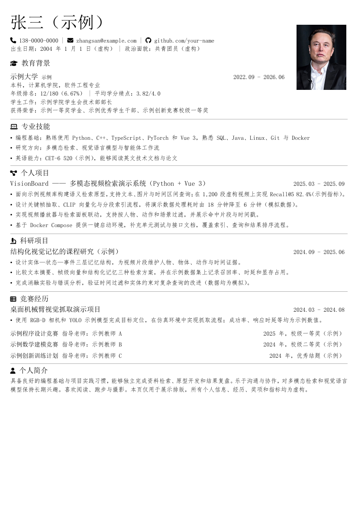

# resume

**Typst 中文单页简历模板**


一个与个人简历保持相同版式的中文单页简历工程，包含完整源码、字体配置、构建脚本和示例 PDF。适合直接 Fork 后替换为自己的经历。

> [!IMPORTANT]
> 姓名、联系方式、学校、经历、项目、奖项、指标和照片均为虚构示例，不对应任何真实个人或事实。

## 预览

<p align="center">
  <a href="./resume.pdf">
    
  </a>
</p>

<p align="center">
  <a href="./resume.pdf">查看 PDF</a>
  ·
  <a href="./resume-cn.typ">查看源码</a>
</p>

## 特性

- 单页 A4 中文简历，使用 Typst 原生排版。
- 共享样式模块，正文、标题、列表和经历条目结构清晰。
- 输出带标题、作者、中文语言和图片替代文本的可访问 PDF。
- 构建前检查所需字体，避免缺少字体时静默生成乱码。
- 所有展示数据均为 mock，可直接替换为个人内容。

## 快速开始

### 环境要求

- Typst 0.15.1
- `SimSun`、`FangSong`、`STFangsong` 字体
- Windows PowerShell 或 GNU Make

### 构建

```powershell
git clone https://github.com/XXXXXQ-0206/resume.git
cd resume
./make.ps1
```

macOS / Linux：

```sh
git clone https://github.com/XXXXXQ-0206/resume.git
cd resume
make
```

生成文件为 `resume.pdf`。清理产物：

```text
./make.ps1 clean
make clean
```

## 自定义

| 文件 | 用途 |
| --- | --- |
| `resume-cn.typ` | 简历内容与个人信息 |
| `chicv.typ` | 页面、标题、列表和条目样式 |
| `fontawesome.typ` | Font Awesome 图标映射 |
| `证件照-黑.jpg` | 简历照片 |
| `make.ps1` / `Makefile` | 构建与清理 |

修改 `resume-cn.typ` 后重新运行构建命令即可。更换照片时，请保持 2.9 × 3.8 cm 的展示比例。

## 项目结构

```text
.
├── assets/
│   └── preview.png
├── fonts/
│   └── FontAwesome6.otf
├── resume-cn.typ
├── chicv.typ
├── fontawesome.typ
├── resume.pdf
├── Makefile
├── make.ps1
└── THIRD_PARTY_NOTICES.md
```

## 验证

项目已在 Typst 0.15.1 下验证：

- 构建成功，输出为单页 A4 PDF；
- PDF/UA-1 校验通过；
- 字体已嵌入，链接和中文语言元数据正常；
- README 预览图由当前 `resume.pdf` 渲染生成。

## 贡献

欢迎提交 Issue 或 Pull Request。提交示例内容时请确保不包含真实个人、学校、公司或联系方式。

## 第三方组件

本项目使用 [typst-fontawesome](https://github.com/duskmoon314/typst-fontawesome) 和 [Font Awesome Free](https://fontawesome.com)。许可证文本见 [THIRD_PARTY_NOTICES.md](./THIRD_PARTY_NOTICES.md)。
